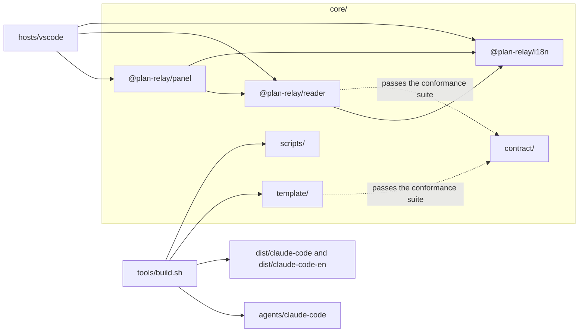
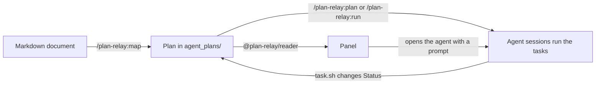

**English** | [Português](ARCHITECTURE.pt-BR.md)

# Architecture

How plan-relay is put together: the layers, which way the dependencies point, how a document becomes a plan that agents run and a panel shows, the words the project uses, and why the main design choices are what they are. For the file-by-file layout, the build and the test suites, see [docs/development.md](docs/development.md); for the plan format, the [contract](core/contract/contract.md).

## Layers

```
core/                     nothing about any agent or editor
  contract/               the plan contract: contract.md, JSON Schema, conformance suite
  template/               what is copied into each plan: README, _template.md, status.sh, task.sh, map.sh
  scripts/                plugin scripts that run outside a plan: check, boundary, summary, idea
  i18n/     @plan-relay/i18n     short texts per language, for the panel and the scripts
  reader/   @plan-relay/reader   reads the plans and computes the state of status.sh --json, without running it
  panel/    @plan-relay/panel    view model, render, CSS and messages of the panel; no host API, no Node API
agents/<agent>/           adapter: skills, hooks, agent scripts, agent.conf (values of the {{AGENT_…}} markers)
hosts/<host>/             panel host: today vscode/, the VS Code extension
dist/<agent>[-en]/        the installable plugin, generated by tools/build.sh from core/ + agents/<agent>/
tools/                    build, embedded strings, versions, release, and the suites in tools/tests/
```

`core/` is the single source. An **adapter** holds what only one coding agent uses; a **host** holds what only one editor or app uses. Today there is one of each: Claude Code (`agents/claude-code/`) and VS Code (`hosts/vscode/`).

## Dependency direction



- Solid arrows are TypeScript imports: `hosts/vscode` → `@plan-relay/panel` → `@plan-relay/reader` → `@plan-relay/i18n`, and the host also imports the reader and i18n directly. Nothing in `core/` imports from `hosts/` or `agents/`.
- How it is enforced:
  - **npm workspaces with `exports`:** each package says what is public; anything else cannot be imported by name.
  - **TypeScript project references (`composite`):** an import from outside a package, or from a package it does not declare, does not compile. `core/panel` and `core/i18n` compile without the Node types.
  - **`no-restricted-imports` per layer** in [eslint.config.mjs](eslint.config.mjs): `vscode` is forbidden in `core/`; `node:*` and `@plan-relay/reader/node` are forbidden in `core/panel` and `core/i18n`, which run in the browser; in `core/reader`, `node:*` is allowed only in `src/node.ts` and in the test fixture.
  - **[architecture.test.ts](hosts/vscode/src/architecture.test.ts)** for what the lint rule does not see: `import('vscode')` and `require('vscode')`.
- `agents/` is imported by nobody in TypeScript: it reaches users through the build, which joins it with `core/template/` and `core/scripts/` into `dist/`. The host talks to the agent through a **provider** ([hosts/vscode/src/agents/provider.ts](hosts/vscode/src/agents/provider.ts)).
- The shell scripts of `core/template/` depend on nothing but `sh`, `awk`, `sed` and `jq`: they are copied into each plan.

## End-to-end flow



1. **Document → `map`.** In a project, `/plan-relay:map <document>.md` (or "Create tasks from this plan" in VS Code) designs phases and tasks and, once approved, copies `core/template/` into `agent_plans/<name>/` with `plan.json`, `PLAN.md`, `MAP.md` and the task files.
2. **Plan.** The state lives only in the task headers (`Status:`, `Blocked by:`…), as the [contract](core/contract/contract.md) defines. `status.sh` computes the state, `task.sh` is the only way to change `Status:`, and `map.sh` rewrites `MAP.md`.
3. **`plan` / `run`.** `/plan-relay:plan <plan> [ID]` gives the briefing, claims, runs and closes one task in one session. `/plan-relay:run` drives the whole plan with parallel workers, stops when it needs the owner, and hands over when the context runs out.
4. **Panel.** The extension finds `agent_plans/*/plan.json` with `@plan-relay/reader`, which computes the same state as `status.sh --json` without running any script from the workspace, draws it with `@plan-relay/panel` and, for each action, opens the agent with the prompt (`/plan-relay:plan …`, `/plan-relay:run …`, `/plan-relay:map …`) in its text box, without sending it.

## Glossary

The words the README, the skills and the panel use. The contract keys stay in English in every plan, whatever the plan's language.

- **Plan:** a folder `agent_plans/<name>/` with `plan.json`. Its `README.md` is the protocol an agent follows.
- **Phase:** a folder `phase-N-<slug>/` with `PHASE.md`. Phases give the order of priority, not of execution.
- **Task:** a file `F<n>-<nn>-<slug>.md` with a contract header; it fits in one or two agent sessions.
- **Subtask:** a task whose ID is its parent's with `.<n>` appended (`F<n>-<nn>.<n>`), created by another task during the work.
- **Status:** `draft`, `ready`, `in-progress`, `done`, `cancelled`, `abandoned`.
- **Type:** `code`, `research`, `prototype`, `decision`, `human`, `review`.
- **Tier:** `junior`, `mid` or `senior`: how much judgement a task needs, and which model the autopilot uses for it.
- **Track:** the thread of work a task belongs to, for filtering.
- **Blocked by / unblocks:** the edges between tasks; the only thing that decides whether a task can start.
- **Owner:** the person who decides. `decision` and `human` tasks wait for them.
- **Log / next step:** the `## Log` section each session appends to; while a task is `in-progress`, it ends in a `Next step:` that the next session resumes from.
- **Cancel / replacement:** the agent swaps a task for another (`Replaced by:`) without losing work.
- **Give up / reopen:** the owner takes a task out of the plan, together with everything that depended on it; reopening undoes that as a group. Cancelling and giving up both take a one-sentence **reason**, which goes to the `## Log`.
- **Idea:** a plan not yet mapped, in `agent_plans/_ideas/<slug>.md`. `refine` sharpens it by questions until it is ready to map; its `Open questions:` line counts what is still undecided.
- **Map:** turning a document or an idea into a plan; also `MAP.md`, the generated list of tasks by phase.
- **Run / autopilot / conductor / worker:** one execution of the autopilot; the session that drives it; each subagent that runs one task.
- **Handoff:** the record of where a session stopped, so another one can continue without the conversation.
- **Boundary:** what the autopilot may do without asking the owner (`boundary.sh`).
- **Usage window:** the 5-hour subscription quota the autopilot can check before starting work.
- **Contract:** the keys and values the scripts read, versioned in `plan.json` (`contract`).
- **Template / version stamp:** the files copied into each plan; the `# scripts_version:` line that says which version a copy is.
- **Profile:** `full` or `lean`. `full` has `spec/`, `research/`, `prototypes/`, a review closing every phase and later phases in `draft`; `lean` is for a small plan, with every task written in full and none of that.
- **Support level:** what an agent can do with plan-relay: 1, protocol (follow the plan's README); 2, commands (the skills); 3, autopilot.
- **Adapter / host / provider:** what only one agent uses; what only one editor or app uses; the part of a host that talks to one agent.
- **Marker:** a `{{AGENT_…}}` placeholder in `core/` that the build fills from the adapter's `agent.conf`.

## Design principles

- **Scripts copied into the plan, self-contained.** `status.sh`, `task.sh` and `map.sh` live inside each plan and do not depend on the installed plugin. Why: the plan belongs to the project and travels with it (another machine, another agent, support level 1); updating the plugin does not change how a plan already under way behaves. The code they share (the task header reader and writer, the texts of each language) is embedded in each script by `tools/script-strings.sh`, not sourced from elsewhere, and the `# scripts_version:` stamp says which version a copy is.
- **A written contract with a conformance suite.** The plan format is a written [contract](core/contract/contract.md), with a JSON Schema and a conformance suite (`core/contract/conformance/`) that both `status.sh`/`task.sh` and `@plan-relay/reader` pass. Why: the same rules have two implementations, one in shell and one in TypeScript, and the suite is what keeps them equal.
- **`dist/` generated and versioned.** The installable plugin is generated by `tools/build.sh` and goes into the same commit as its source; CI refuses an out-of-date `dist/` (`--check`). Why: a Claude Code plugin reads only files from its own folder, and a git marketplace reads the repository as it is, with no build step.
- **A shell test harness with no dependencies.** The shell suites are plain `sh` with a home-made harness ([tools/tests/lib.sh](tools/tests/lib.sh)). Why: testing POSIX scripts should not require bats, Node or Python; the suites run the same on macOS, on the Ubuntu CI and in a container, wherever the scripts they test run.
- **No `set -eu` in the plan and plugin scripts.** The scripts that run on a user's machine (`core/`, `agents/`) handle each error where it happens, with their own message and exit code. Why: `set -e` behaves differently across shells and is silently ignored inside functions called from `if`, `&&` or `||`, so it hides the cause of a failure instead of reporting it; `set -u` breaks on optional environment variables. The choice is deliberate, not an oversight. `tools/ci-tools.sh`, a short CI download script with no optional variables, is the one exception.
- **A core with no agent and no editor.** What belongs to Claude Code is in `agents/claude-code/`; what belongs to VS Code is in `hosts/vscode/`. Why: the plan format is open, and another agent or another editor comes in with an adapter, a provider or a host, without touching `core/`. `core/` writes `{{AGENT_…}}` markers where the invocation syntax goes, and the build fills them in. The case that shaped this is **ZCode**, a third-party coding agent with a desktop app: it would show the same panel (a host without a title bar, so the panel keeps its own actions row) and needs its own provider (it may not install the plugin or open with a prompt, and then the panel copies the prompt). It also leaves plugin variables such as `${CLAUDE_PLUGIN_ROOT}` unsubstituted in a skill's body, which is why the plugin path reaches the skills through a hook. No ZCode host or provider ships today, and the README promises only Claude Code; the code names ZCode where a decision was made with it in mind.
- **The panel does not run workspace scripts.** The reader computes the state in TypeScript. Why: opening a folder should not execute code from it.
- **Literal commands in the skills.** One shell call per command, with no `$VAR`, `$(…)`, pipes or `&&` ([agents/claude-code/COMMANDS.md](agents/claude-code/COMMANDS.md)). Why: the agent's permission system checks each call against rules; a compound command does not match, and on autopilot nobody is there to approve it.
