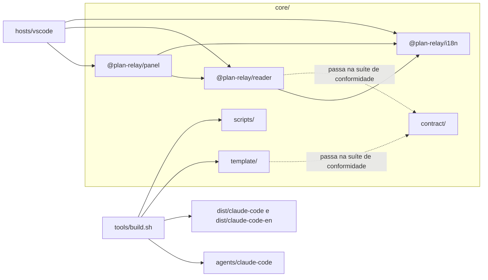
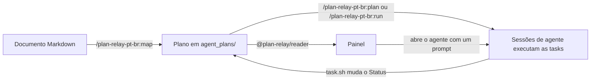

[English](ARCHITECTURE.md) | **Português**

# Arquitetura

Como o plan-relay se monta: as camadas, para que lado apontam as dependências, como um documento vira um plano que agentes executam e um painel mostra, as palavras que o projeto usa e por que as principais escolhas de desenho são as que são. Para o layout arquivo a arquivo, o build e as suítes de teste, veja o [docs/development.md](docs/development.md) (em inglês); para o formato do plano, o [contrato](core/contract/contract.md).

## Camadas

```
core/                     nada de agente nem de editor
  contract/               o contrato do plano: contract.md, JSON Schema, suíte de conformidade
  template/               o que se copia para cada plano: README, _template.md, status.sh, task.sh, map.sh
  scripts/                scripts do plugin que rodam fora de um plano: check, boundary, summary, idea
  i18n/     @plan-relay/i18n     textos curtos por língua, para o painel e os scripts
  reader/   @plan-relay/reader   lê os planos e calcula o estado do status.sh --json, sem rodá-lo
  panel/    @plan-relay/panel    modelo de vista, render, CSS e mensagens do painel; sem API de host nem de Node
agents/<agente>/          adaptador: skills, hooks, scripts do agente, agent.conf (valores dos marcadores {{AGENT_…}})
hosts/<host>/             hospedeiro do painel: hoje vscode/, a extensão do VS Code
dist/<agente>[-en]/       o plugin instalável, gerado por tools/build.sh a partir de core/ + agents/<agente>/
tools/                    build, textos embutidos, versões, release e as suítes de tools/tests/
```

O `core/` é a fonte única. Um **adaptador** guarda o que só um agente de código usa; um **hospedeiro** (host), o que só um editor ou aplicativo usa. Hoje há um de cada: o Claude Code (`agents/claude-code/`) e o VS Code (`hosts/vscode/`).

## Direção das dependências



- As setas cheias são imports de TypeScript: `hosts/vscode` → `@plan-relay/panel` → `@plan-relay/reader` → `@plan-relay/i18n`, e o host também importa o reader e o i18n diretamente. Nada no `core/` importa de `hosts/` nem de `agents/`.
- Como se garante:
  - **npm workspaces com `exports`:** cada pacote diz o que é público; o resto não se importa pelo nome.
  - **Project references do TypeScript (`composite`):** um import de fora do pacote, ou de um pacote que ele não declara, não compila. `core/panel` e `core/i18n` compilam sem os tipos do Node.
  - **`no-restricted-imports` por camada** no [eslint.config.mjs](eslint.config.mjs): `vscode` é proibido no `core/`; `node:*` e `@plan-relay/reader/node` são proibidos em `core/panel` e `core/i18n`, que rodam no navegador; no `core/reader`, `node:*` só é aceito em `src/node.ts` e na fixture de teste.
  - **[architecture.test.ts](hosts/vscode/src/architecture.test.ts)** para o que a regra de lint não vê: `import('vscode')` e `require('vscode')`.
- Ninguém importa `agents/` em TypeScript: ele chega a quem usa pelo build, que o junta com `core/template/` e `core/scripts/` no `dist/`. O host fala com o agente por um **provedor** ([hosts/vscode/src/agents/provider.ts](hosts/vscode/src/agents/provider.ts)).
- Os scripts shell do `core/template/` não dependem de nada além de `sh`, `awk`, `sed` e `jq`: são copiados para dentro de cada plano.

## Fluxo de ponta a ponta



1. **Documento → `map`.** Num projeto, `/plan-relay-pt-br:map <documento>.md` (ou «Criar tasks deste plano» no VS Code) desenha fases e tasks e, aprovado, copia `core/template/` para `agent_plans/<nome>/` com `plan.json`, `PLAN.md`, `MAP.md` e os arquivos das tasks.
2. **Plano.** O estado vive só nos cabeçalhos das tasks (`Status:`, `Blocked by:`…), como o [contrato](core/contract/contract.md) define. O `status.sh` calcula o estado, o `task.sh` é a única forma de mudar `Status:` e o `map.sh` reescreve o `MAP.md`.
3. **`plan` / `run`.** `/plan-relay-pt-br:plan <plano> [ID]` faz o briefing, reclama, executa e fecha uma task numa sessão. `/plan-relay-pt-br:run` conduz o plano inteiro com trabalhadores em paralelo, para quando precisa do dono e passa o bastão quando o contexto acaba.
4. **Painel.** A extensão acha `agent_plans/*/plan.json` com o `@plan-relay/reader`, que calcula o mesmo estado do `status.sh --json` sem rodar nenhum script do workspace, desenha com o `@plan-relay/panel` e, em cada ação, abre o agente com o prompt (`/plan-relay-pt-br:plan …`, `/plan-relay-pt-br:run …`, `/plan-relay-pt-br:map …`) na caixa de texto, sem enviá-lo.

## Glossário

As palavras que o README, as skills e o painel usam, com o nome inglês entre parênteses quando é ele que aparece no código. As chaves do contrato ficam em inglês em todo plano, seja qual for a língua dele.

- **Plano (plan):** uma pasta `agent_plans/<nome>/` com `plan.json`. O `README.md` dela é o protocolo que o agente segue.
- **Fase (phase):** uma pasta `phase-N-<slug>/` com `PHASE.md`. As fases dão a ordem de prioridade, não a de execução.
- **Task:** um arquivo `F<n>-<nn>-<slug>.md` com cabeçalho do contrato; cabe numa ou duas sessões de agente.
- **Subtask:** uma task cujo ID é o da mãe com `.<n>` no fim (`F<n>-<nn>.<n>`), criada por outra task durante o trabalho.
- **Status:** `draft`, `ready`, `in-progress`, `done`, `cancelled`, `abandoned`.
- **Tipo (type):** `code`, `research`, `prototype`, `decision`, `human`, `review`.
- **Nível (tier):** `junior`, `mid` ou `senior`: quanto julgamento a task pede, e que modelo o piloto automático usa nela.
- **Trilha (track):** o fio de trabalho a que a task pertence, para filtrar.
- **Bloqueada por / desbloqueia (blocked by / unblocks):** as arestas entre tasks; a única coisa que decide se uma task pode começar.
- **Dono (owner):** a pessoa que decide. As tasks `decision` e `human` esperam por ela.
- **Log / próximo passo (next step):** a seção `## Log` a que cada sessão acrescenta uma entrada; enquanto a task está `in-progress`, ela termina num `Next step:` de onde a sessão seguinte retoma.
- **Cancelar / substituta (cancel / replacement):** o agente troca uma task por outra (`Replaced by:`) sem perder trabalho.
- **Desistir / reabrir (give up / reopen):** o dono tira uma task do plano junto com tudo o que dependia dela; reabrir desfaz isso, em grupo. Cancelar e desistir pedem um **motivo** (reason) numa frase, que vai para o `## Log`.
- **Ideia (idea):** um plano ainda por mapear, em `agent_plans/_ideas/<slug>.md`. O `refine` a afina por perguntas até ela ficar pronta para mapear; a linha `Open questions:` conta o que ainda está por decidir.
- **Mapear (map):** transformar um documento ou uma ideia num plano; também o `MAP.md`, a lista gerada das tasks por fase.
- **Corrida / piloto automático / condutora / trabalhador (run / autopilot / conductor / worker):** uma execução do piloto automático; a sessão que o conduz; cada subagente que executa uma task.
- **Bastão (handoff):** o registro de onde a sessão parou, para outra continuar sem a conversa.
- **Fronteira (boundary):** o que o piloto automático pode fazer sem perguntar ao dono (`boundary.sh`).
- **Janela de uso (usage window):** a cota de 5 horas da assinatura, que o piloto automático pode consultar antes de começar.
- **Contrato (contract):** as chaves e os valores que os scripts leem, versionados no `plan.json` (`contract`).
- **Modelo / carimbo de versão (template / version stamp):** os arquivos copiados para cada plano; a linha `# scripts_version:` que diz de que versão é a cópia.
- **Perfil (profile):** `full` ou `lean`. O `full` tem `spec/`, `research/`, `prototypes/`, um review no fecho de toda fase e as fases adiante em `draft`; o `lean` é para um plano pequeno, com todas as tasks escritas por inteiro e nada disso.
- **Nível de suporte:** o que um agente consegue fazer com o plan-relay: 1, protocolo (seguir o README do plano); 2, comandos (as skills); 3, piloto automático.
- **Adaptador / hospedeiro / provedor (adapter / host / provider):** o que só um agente usa; o que só um editor ou aplicativo usa; a parte do hospedeiro que fala com um agente.
- **Marcador (marker):** um `{{AGENT_…}}` no `core/` que o build preenche a partir do `agent.conf` do adaptador.

## Princípios de desenho

- **Scripts copiados para o plano, autossuficientes.** O `status.sh`, o `task.sh` e o `map.sh` vivem dentro de cada plano e não dependem do plugin instalado. Por quê: o plano é do projeto e anda com ele (outra máquina, outro agente, nível de suporte 1); atualizar o plugin não muda como se comporta um plano já em curso. O código que eles partilham (o leitor e o escritor do cabeçalho da task, os textos de cada língua) é embutido em cada script pelo `tools/script-strings.sh`, não carregado de fora, e o carimbo `# scripts_version:` diz de que versão é a cópia.
- **Um contrato escrito, com suíte de conformidade.** O formato do plano é um [contrato](core/contract/contract.md) escrito, com JSON Schema e uma suíte de conformidade (`core/contract/conformance/`) em que passam tanto o `status.sh`/`task.sh` quanto o `@plan-relay/reader`. Por quê: as mesmas regras têm duas implementações, uma em shell e outra em TypeScript, e a suíte é o que as mantém iguais.
- **`dist/` gerado e versionado.** O plugin instalável é gerado pelo `tools/build.sh` e entra no mesmo commit da fonte; o CI recusa um `dist/` desatualizado (`--check`). Por quê: um plugin do Claude Code só lê arquivos da própria pasta, e um marketplace git lê o repositório como está, sem passo de build.
- **Harness de teste em shell, sem dependência.** As suítes shell são `sh` puro, com um harness feito em casa ([tools/tests/lib.sh](tools/tests/lib.sh)). Por quê: testar scripts POSIX não deve exigir bats, Node nem Python; as suítes rodam igual no macOS, no Ubuntu do CI e num container, onde quer que rodem os scripts que elas testam.
- **Sem `set -eu` nos scripts do plano e do plugin.** Os scripts que rodam na máquina de quem usa (`core/`, `agents/`) tratam cada erro onde ele acontece, com mensagem e código de saída próprios. Por quê: o `set -e` se comporta de forma diferente entre shells e é ignorado em silêncio dentro de funções chamadas de um `if`, `&&` ou `||`, então esconde a causa da falha em vez de mostrá-la; o `set -u` quebra com variáveis de ambiente opcionais. A escolha é deliberada, não um esquecimento. O `tools/ci-tools.sh`, um script curto de download do CI sem variáveis opcionais, é a única exceção.
- **Um núcleo sem agente nem editor.** O que é do Claude Code fica em `agents/claude-code/`; o que é do VS Code, em `hosts/vscode/`. Por quê: o formato do plano é aberto, e outro agente ou outro editor entram com um adaptador, um provedor ou um hospedeiro, sem tocar no `core/`. O `core/` escreve marcadores `{{AGENT_…}}` onde vai a sintaxe de invocação, e o build os preenche. O caso que deu forma a isso é o **ZCode**, um agente de código de terceiros com aplicativo de desktop: ele mostraria o mesmo painel (um hospedeiro sem barra de título, então o painel mantém a própria linha de ações) e precisa do seu próprio provedor (pode não saber instalar o plugin nem abrir com um prompt, e então o painel copia o prompt). Ele também deixa variáveis do plugin como `${CLAUDE_PLUGIN_ROOT}` sem substituir no corpo de uma skill, e é por isso que o caminho do plugin chega às skills por um hook. Nenhum hospedeiro nem provedor do ZCode sai hoje, e o README só promete o Claude Code; o código cita o ZCode onde uma decisão foi tomada pensando nele.
- **O painel não roda scripts do workspace.** O reader calcula o estado em TypeScript. Por quê: abrir uma pasta não deve executar código dela.
- **Comandos literais nas skills.** Uma chamada de shell por comando, sem `$VAR`, `$(…)`, pipes nem `&&` ([agents/claude-code/COMMANDS.md](agents/claude-code/COMMANDS.md)). Por quê: o sistema de permissões do agente confere cada chamada contra regras; um comando composto não casa e, no piloto automático, ninguém está ali para aprovar.
