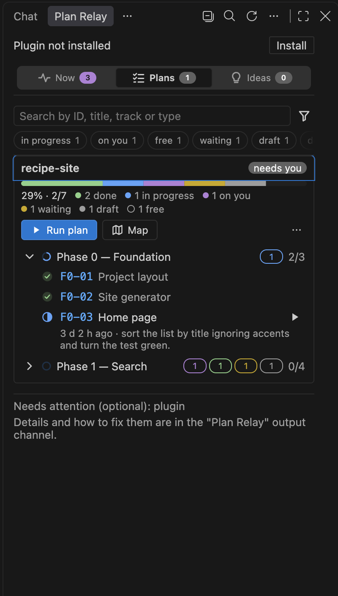

**English** | [Português](README.pt-BR.md)

# plan-relay

[](https://github.com/saboyafelipe/plan-relay/actions/workflows/ci.yml) [](https://marketplace.visualstudio.com/items?itemName=saboyafelipe.plan-relay) [](LICENSE)

Work plans split into tasks, run by coding agents, one task per session. You write a plan (or map one from a document); the agent runs it task by task, resumes where it stopped and, on autopilot, drives the whole plan and stops when it needs you.

Today plan-relay is a Claude Code plugin (skills `map`, `plan`, `run`, `check`, `idea`, `refine`, `handoff`) and a VS Code extension, with a panel that shows the plans in your workspace and opens the agent with the prompt for each action.



## Requirements

- **Claude Code**, where the plugin's skills run.
- **`jq`** on the PATH. The panel footer warns you when it is missing.
- **On Windows,** Git Bash or WSL: the scripts are `sh`. Task files saved with CRLF line endings are read like LF ones, but CI runs only on macOS and Linux: Windows is not tested there.
- **Node and npm,** only to build the VS Code extension from a clone (step 2 below).

## First use

1. Install the plugin: `claude plugin marketplace add saboyafelipe/plan-relay`, then `claude plugin install plan-relay@plan-relay`. Its skills talk to you in English. For skills in Brazilian Portuguese, install `plan-relay-pt-br@plan-relay` instead; its commands start with `/plan-relay-pt-br:` (`/plan-relay-pt-br:map`, `/plan-relay-pt-br:plan`…). Install one of the two, not both. The VS Code extension installs the one that matches the language of VS Code.
2. Install the VS Code extension from the marketplace: `saboyafelipe.plan-relay`. If the marketplace does not list it yet, build it from a clone and install the `.vsix`, as in "Install the extension from a clone" in [docs/development.md](docs/development.md#install-the-extension-from-a-clone).
3. In a Claude Code session at the root of your project, map a document: `/plan-relay:map <document>.md`. The skill designs the tasks, waits for your approval and writes the plan to `agent_plans/<name>/`.
4. Open the project in VS Code, trust the workspace when asked, open the panel ("Plan Relay" icon in the secondary side bar) and click "Run" on a free task, or "Run plan" for autopilot.
5. If something is missing from your environment, `/plan-relay:check` tells you what it is and how to fix it.

## A task file

Each task is a Markdown file in a phase folder of the plan, `agent_plans/<plan>/phase-<n>-<slug>/`. The lines above the title are the header that the scripts and the panel read; the sections below it are for the agent and for you. Trimmed:

```markdown
Status: in-progress
Started: 2026-03-02T09:14Z
Type: code
Track: search
Tier: mid
Blocked by: <the ID of the task that writes the recipes>

# <ID> - Ingredient index

## Goal
The build writes `out/index.json`, which maps each ingredient to the recipes that use it.

## Read first
## Deliverables
## Steps

## Done when
- [x] `npm test -- index` passes, with the shared ingredient listing both recipes.
- [ ] `## Log` filled in.

## Log
### 2026-03-02 — session 1
- Done: the index and its test, green.
- Next step: call the index from `build` and check `out/index.json`.
```

`Status:` changes only through the plan's `task.sh` (`claim`, `close`…), and `close` refuses while a `- [ ]` is left under `## Done when`. A session that stops writes its `Next step:` in the `## Log`, and the next one, days later and without memory of this one, resumes from there. The whole file is [fixtures/task-example.md](fixtures/task-example.md); every key is in the [plan contract](core/contract/contract.md).

## Support levels by agent

| Level | What the agent needs | What it delivers | Who is there |
|---|---|---|---|
| 1. Protocol | read Markdown and run a command | run and resume tasks by following the plan's `README.md` | any agent |
| 2. Commands | installable slash commands, skills or prompts | ideas, mapping, briefing, run by command | Claude Code |
| 3. Autopilot | parallel subagents, hooks, structured questions | drive the plan unsupervised | Claude Code |

Only Claude Code is proven today, on all three levels. Level 1 holds for any agent that reads Markdown and runs `sh`; levels 2 and 3 depend on what the agent offers, and no other agent has been validated.

## Limits

- **5-hour quota:** autopilot can read your subscription usage with a real call to Claude Code. It is off until you turn it on, from the panel's ⋯ menu ("5-hour window gate…") or with `PLAN_RELAY_WINDOW=on`. See [docs/development.md](docs/development.md#5-hour-window) for the costs.

## Accessibility

Accessibility is a requirement of the panel, checked by its tests like any other rule. The panel guarantees:

- **Keyboard:** each tree (the tasks of a plan, the ideas) is one Tab stop, and the actions of a task or an idea are also in the detail that opens from its tree item.
- **Not only color:** no state is told only by a color or a tooltip. The Now tab says in its name how many tasks wait on you; a dependency still missing says so in its name.
- **Announced changes:** one live region says the host notices and the filter count when they change.
- **System settings:** under forced colors (high-contrast modes of the system), toggled controls take the system highlight and each status keeps its own shape; with reduced motion, nothing spins.
- **Contrast inherited from the theme:** the panel has no color of its own; every color comes from the editor theme, so its contrast is the theme's, and the high-contrast themes of VS Code apply as they are.

How it is tested: `core/panel/src/a11y.test.ts` checks the cases above on the DOM the panel draws, and `core/panel/src/axe.test.ts` runs the WCAG 2.x A and AA rules of axe-core over each view, with a planted violation that proves it fails. Contrast is not measured there: the test DOM has no layout, and the colors are the theme's.

## Documentation

- [hosts/vscode/README.md](hosts/vscode/README.md): the VS Code extension, its requirements and settings.
- [ARCHITECTURE.md](ARCHITECTURE.md): the layers, how they depend on each other and the design principles.
- [core/contract/contract.md](core/contract/contract.md): the plan contract (header, status, log).
- [CONTRIBUTING.md](CONTRIBUTING.md): how to propose a change.
- [docs/autopilot.md](docs/autopilot.md): `/plan-relay:run`, the autopilot that drives a whole plan and stops when it needs you.
- [docs/development.md](docs/development.md): repository layout, plugin build, test suites, the extension in development, state of the scripts.
- [SECURITY.md](SECURITY.md): how to report a vulnerability, in private.
- [CHANGELOG.md](CHANGELOG.md): what changed in each version.

## License

MIT. See the [LICENSE](LICENSE) file.

plan-relay is an independent project, not affiliated with or endorsed by Anthropic or Microsoft. Claude Code and Visual Studio Code are trademarks of their respective owners.
