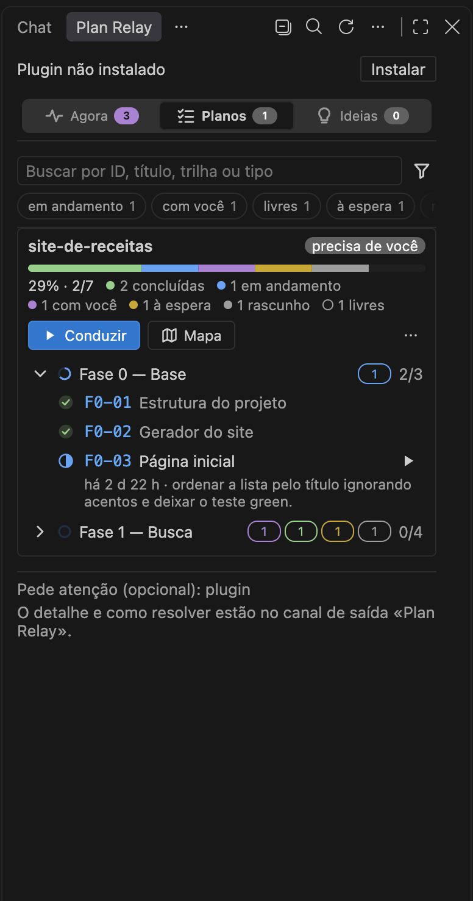

[English](README.md) | **Português**

# plan-relay

[](https://github.com/saboyafelipe/plan-relay/actions/workflows/ci.yml) [](https://marketplace.visualstudio.com/items?itemName=saboyafelipe.plan-relay) [](LICENSE)

Planos de trabalho em tasks, executados por agentes de código, uma task por sessão. Você escreve (ou mapeia de um documento) um plano; o agente executa task a task, retoma de onde parou e, no piloto automático, conduz o plano inteiro e para quando precisa de você.

Hoje o plan-relay é um plugin do Claude Code (skills `map`, `plan`, `run`, `check`, `idea`, `refine`, `handoff`) e uma extensão do VS Code, com um painel que mostra os planos do workspace e abre o agente com o prompt de cada ação.



## Requisitos

- **Claude Code**, onde rodam as skills do plugin.
- **`jq`** no PATH. O rodapé do painel avisa quando falta.
- **No Windows,** Git Bash ou WSL: os scripts são `sh`. Arquivos de task salvos com fim de linha CRLF são lidos como os LF, mas o CI roda só em macOS e Linux: o Windows não é testado lá.
- **Node e npm,** só para compilar a extensão do VS Code a partir de um clone (passo 2 abaixo).

## Primeiro uso

1. Instale o plugin: `claude plugin marketplace add saboyafelipe/plan-relay` e depois `claude plugin install plan-relay-pt-br@plan-relay`, com as skills em português do Brasil; os comandos dele começam por `/plan-relay-pt-br:`. O `plan-relay@plan-relay` é o mesmo plugin com as skills em inglês, e os comandos começam por `/plan-relay:`. Instale um dos dois, não ambos. A extensão do VS Code instala o da língua do VS Code.
2. Instale a extensão do VS Code pela loja: `saboyafelipe.plan-relay`. Se a loja ainda não a tiver, compile-a a partir de um clone e instale o `.vsix`, como em «Install the extension from a clone» no [docs/development.md](docs/development.md#install-the-extension-from-a-clone) (em inglês).
3. Numa sessão do Claude Code na raiz do seu projeto, mapeie um documento: `/plan-relay-pt-br:map <documento>.md`. A skill desenha as tasks, espera a sua aprovação e escreve o plano em `agent_plans/<nome>/`.
4. Abra o projeto no VS Code, confie no workspace quando ele perguntar, abra o painel (ícone «Plan Relay» da barra lateral secundária) e clique em «Executar» numa task livre, ou em «Conduzir» para o piloto automático.
5. Se algo faltar no ambiente, `/plan-relay-pt-br:check` diz o que é e como resolver.

## Um arquivo de task

Cada task é um arquivo Markdown numa pasta de fase do plano, `agent_plans/<plano>/phase-<n>-<slug>/`. As linhas acima do título são o cabeçalho que os scripts e o painel leem; as seções abaixo dele são para o agente e para você. Resumido:

```markdown
Status: in-progress
Started: 2026-03-02T09:14Z
Type: code
Track: busca
Tier: mid
Blocked by: <o ID da task que escreve as receitas>

# <ID> - Índice de ingredientes

## Objetivo
O build escreve `saida/indice.json`, que liga cada ingrediente às receitas que o usam.

## Ler antes
## Entregáveis
## Passos

## Done when
- [x] `npm test -- indice` passa, com o ingrediente comum listando as duas receitas.
- [ ] `## Log` preenchido.

## Log
### 2026-03-02 — sessão 1
- Feito: o índice e o teste dele, verde.
- Next step: chamar o índice no `build` e conferir `saida/indice.json`.
```

O `Status:` muda só pelo `task.sh` do plano (`claim`, `close`…), e o `close` recusa enquanto restar um `- [ ]` em `## Done when`. Uma sessão que para escreve o `Next step:` no `## Log`, e a seguinte, dias depois e sem memória desta, retoma dali. As chaves e os marcadores do contrato ficam em inglês; o resto segue a língua do plano. O arquivo inteiro está em [fixtures/task-example.pt-BR.md](fixtures/task-example.pt-BR.md); cada chave está no [contrato do plano](core/contract/contract.md) (em inglês).

## Níveis de suporte por agente

| Nível | O que o agente precisa | O que entrega | Quem está aí |
|---|---|---|---|
| 1. Protocolo | ler Markdown e rodar um comando | executar e retomar tasks seguindo o `README.md` do plano | qualquer agente |
| 2. Comandos | slash commands, skills ou prompts instaláveis | ideias, mapear, briefing, executar por comando | Claude Code |
| 3. Piloto | subagentes em paralelo, hooks, pergunta estruturada | conduzir o plano sem supervisão | Claude Code |

Só o Claude Code está provado hoje, nos três níveis. O nível 1 vale para qualquer agente que leia Markdown e rode `sh`; os níveis 2 e 3 dependem do que o agente oferece, e nenhum outro foi validado.

## Limites

- **Cota de 5 h:** o piloto pode ler o uso da assinatura com uma chamada real ao Claude Code. Fica desligado até você ligar, no menu «⋯» do painel («Portão da janela de 5 h…») ou com `PLAN_RELAY_WINDOW=on`. Veja [docs/development.md](docs/development.md#5-hour-window) (em inglês) para os custos.

## Acessibilidade

A acessibilidade é um requisito do painel, conferido pelos testes dele como qualquer outra regra. O painel garante:

- **Teclado:** cada árvore (as tasks de um plano, as ideias) é uma parada só do Tab, e as ações de uma task ou de uma ideia estão também no detalhe que abre do item dela na árvore.
- **Não só cor:** nenhum estado é dito só por uma cor ou uma dica. A aba Agora diz no nome quantas tasks esperam por você; uma dependência que ainda falta diz isso no nome.
- **Mudanças anunciadas:** uma região viva diz os avisos do host e a contagem do filtro quando mudam.
- **Ajustes do sistema:** com cores forçadas (os modos de alto contraste do sistema), os controles ligados tomam o realce do sistema e cada status mantém uma forma própria; com movimento reduzido, nada gira.
- **Contraste herdado do tema:** o painel não tem cor própria; toda cor vem do tema do editor, então o contraste é o do tema, e os temas de alto contraste do VS Code valem como são.

Como se testa: `core/panel/src/a11y.test.ts` confere os casos acima no DOM que o painel desenha, e `core/panel/src/axe.test.ts` roda as regras WCAG 2.x A e AA do axe-core sobre cada vista, com uma violação plantada que prova que ele falha. O contraste não se mede ali: o DOM de teste não tem layout, e as cores são as do tema.

## Documentação

- [hosts/vscode/README.pt-BR.md](hosts/vscode/README.pt-BR.md): a extensão do VS Code, os requisitos e as configurações.
- [ARCHITECTURE.pt-BR.md](ARCHITECTURE.pt-BR.md): as camadas, como dependem umas das outras e os princípios de desenho.
- [core/contract/contract.md](core/contract/contract.md) (em inglês): o contrato do plano (cabeçalho, status, log).
- [CONTRIBUTING.pt-BR.md](CONTRIBUTING.pt-BR.md): como propor uma mudança.
- [docs/autopilot.pt-BR.md](docs/autopilot.pt-BR.md): `/plan-relay-pt-br:run`, o piloto automático que conduz um plano inteiro e para quando precisa de você.
- [docs/development.md](docs/development.md) (em inglês): estrutura do repositório, build do plugin, suites de prova, extensão em desenvolvimento, estado dos scripts.
- [SECURITY.pt-BR.md](SECURITY.pt-BR.md): como relatar uma vulnerabilidade, em privado.
- [CHANGELOG.md](CHANGELOG.md) (em inglês): o que mudou em cada versão.

## Licença

MIT. Veja o arquivo [LICENSE](LICENSE).

O plan-relay é um projeto independente, sem afiliação nem aval da Anthropic ou da Microsoft. Claude Code e Visual Studio Code são marcas dos seus respectivos donos.
