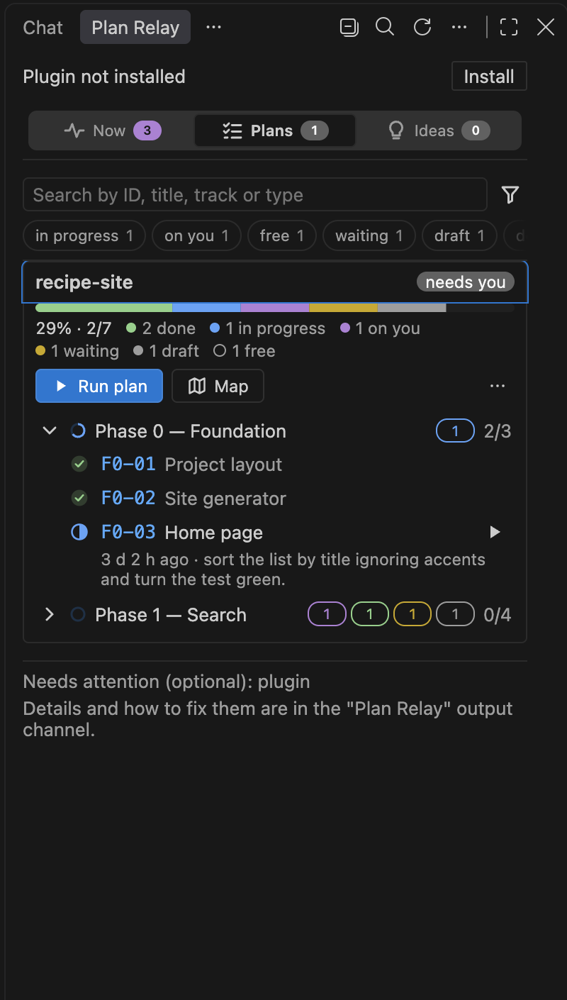

**English** | [Português](https://github.com/saboyafelipe/plan-relay/blob/main/hosts/vscode/README.pt-BR.md)

# Plan Relay

  

A VS Code panel for the work plans that coding agents run task by task. The extension shows the plans in your workspace, the progress of each phase, what is in progress and what is free, and opens Claude Code with the prompt for each action: run or resume a task, drive the plan on autopilot, map a document into tasks.

## Requirements

- **VS Code 1.146 or newer.**
- **Claude Code** with the `plan-relay` plugin. The panel offers to install the plugin when it is missing ("Plan Relay: Install the plugin" command).
- **`jq`** on the PATH. The panel footer warns you when it is missing.
- **On Windows,** Git Bash or WSL: the plan scripts are `sh`.

## First use

1. Open a project folder and trust it when VS Code asks (in restricted mode the panel does not appear). The extension activates when the workspace has an `agent_plans/` folder (with plans or ideas), even if it is in `.gitignore`, or through the "Plan Relay: Show panel" command.
2. No plan yet: right-click a `.md` document in the Explorer and choose "Create tasks from this plan". Claude Code opens with `/plan-relay:map <document>.md`; the skill designs the tasks and waits for your approval.
3. In the panel ("Plan Relay" icon in the secondary side bar), click "Run" on a free task, or "Run plan" for autopilot.

## Settings

| Setting | What it does |
|---|---|
| `planRelay.refreshIntervalMinutes` | Minutes between automatic panel refreshes. `0` turns it off. Default: `5`. |
| `planRelay.claudePath` | Path to the Claude Code binary. Empty uses the official extension's or the one on the PATH. |
| `planRelay.marketplace` | Where to install the plugin from: a clone's folder, a GitHub `owner/repo` or a git URL. Empty picks one for you. |
| `planRelay.notifications.*` | VS Code notices while the panel is open: a task started (`taskStarted`) or finished (`taskCompleted`), a run opened (`runOpened`, off by default) or closed (`runClosed`), which fade after `durationSeconds` (default `6`); and those that stay until you dismiss them, with a button: the baton passed by the run (`handoff`) and a task waiting on you (`taskWaitingOnOwner`). Also fading: a task cancelled (`taskCancelled`, with the one that replaces it) and a give-up (`taskAbandoned`, one notice per give-up with how many tasks fell with it). Each one switches on and off on its own. `sound`: `off` (default), `attention` (only the ones that need you) or `all`. |

## Limits

- The panel only opens in trusted workspaces: it runs the Claude Code binary from the workspace folders.
- Today the agent is Claude Code. The plan format is open and any agent that reads Markdown and runs a command can follow a plan, but the panel buttons open Claude Code.
- The extension does not run anything on its own: it opens the agent with the prompt, and you send it.

## More

The plugin, the plan format and the documentation are in the repository: [github.com/saboyafelipe/plan-relay](https://github.com/saboyafelipe/plan-relay). Problems and suggestions: [issues](https://github.com/saboyafelipe/plan-relay/issues).

MIT license.

Plan Relay is an independent project, not affiliated with or endorsed by Anthropic or Microsoft. Claude Code and Visual Studio Code are trademarks of their respective owners.
