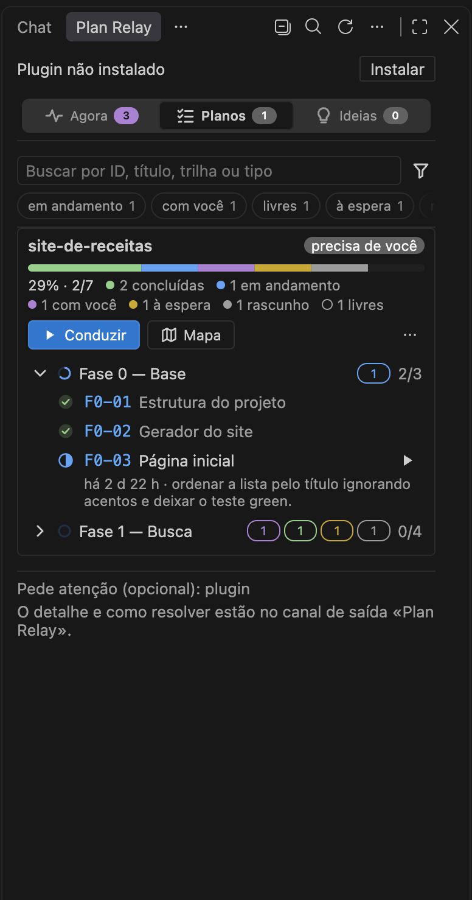

[English](README.md) | **Português**

# Plan Relay

  

Um painel do VS Code para os planos de trabalho que agentes de código executam task a task. A extensão mostra os planos do workspace, o progresso de cada fase, o que está em andamento e o que está livre, e abre o Claude Code com o prompt de cada ação: executar ou retomar uma task, conduzir o plano no piloto automático, mapear um documento em tasks.

## Pré-requisitos

- **VS Code 1.146 ou mais recente.**
- **Claude Code** com o plugin `plan-relay`. O painel oferece instalar o plugin quando ele falta (comando «Plan Relay: Instalar o plugin»).
- **`jq`** no PATH. O rodapé do painel avisa quando falta.
- **No Windows,** Git Bash ou WSL: os scripts dos planos são `sh`.

## Primeiro uso

1. Abra uma pasta de projeto e confie nela quando o VS Code perguntar (em modo restrito o painel não aparece). A extensão ativa quando o workspace tem uma pasta `agent_plans/` (com planos ou ideias), mesmo que ela esteja no `.gitignore`, ou pelo comando «Plan Relay: Mostrar painel».
2. Sem plano ainda: clique com o botão direito num documento `.md` no Explorer e escolha «Criar tasks deste plano». O Claude Code abre com `/plan-relay-pt-br:map <documento>.md`; a skill desenha as tasks e espera a sua aprovação.
3. No painel (ícone «Plan Relay» da barra lateral secundária), clique em «Executar» numa task livre, ou em «Conduzir» para o piloto automático.

## Configurações

| Configuração | O que faz |
|---|---|
| `planRelay.refreshIntervalMinutes` | Minutos entre atualizações automáticas do painel. `0` desliga. Padrão: `5`. |
| `planRelay.claudePath` | Caminho do binário do Claude Code. Vazio usa o da extensão oficial ou o do PATH. |
| `planRelay.marketplace` | De onde instalar o plugin: a pasta de um clone, um `owner/repo` do GitHub ou uma URL git. Vazio escolhe sozinho. |
| `planRelay.notifications.*` | Avisos do VS Code enquanto o painel está aberto: task que começou (`taskStarted`) ou terminou (`taskCompleted`), corrida aberta (`runOpened`, desligado por padrão) ou encerrada (`runClosed`), que somem depois de `durationSeconds` (padrão `6`); e os que ficam até você fechar, com botão: o bastão passado pela condução (`handoff`) e a task esperando você (`taskWaitingOnOwner`). Também somem sozinhos: task cancelada (`taskCancelled`, com a que a substitui) e desistência (`taskAbandoned`, um aviso por desistência, com quantas tasks caíram junto). Cada um liga e desliga só o seu. `sound`: `off` (padrão), `attention` (só os que pedem você) ou `all`. |

## Limites

- O painel só abre em workspaces confiáveis: ele roda o binário do Claude Code a partir das pastas do workspace.
- Hoje o agente é o Claude Code. O formato dos planos é aberto e qualquer agente que leia Markdown e rode um comando consegue seguir um plano, mas os botões do painel abrem o Claude Code.
- A extensão não executa nada sozinha: ela abre o agente com o prompt, e você envia.

## Mais

O plugin, o formato dos planos e a documentação estão no repositório: [github.com/saboyafelipe/plan-relay](https://github.com/saboyafelipe/plan-relay). Problemas e sugestões: [issues](https://github.com/saboyafelipe/plan-relay/issues).

Licença MIT.

O Plan Relay é um projeto independente, sem afiliação nem aval da Anthropic ou da Microsoft. Claude Code e Visual Studio Code são marcas dos seus respectivos donos.
